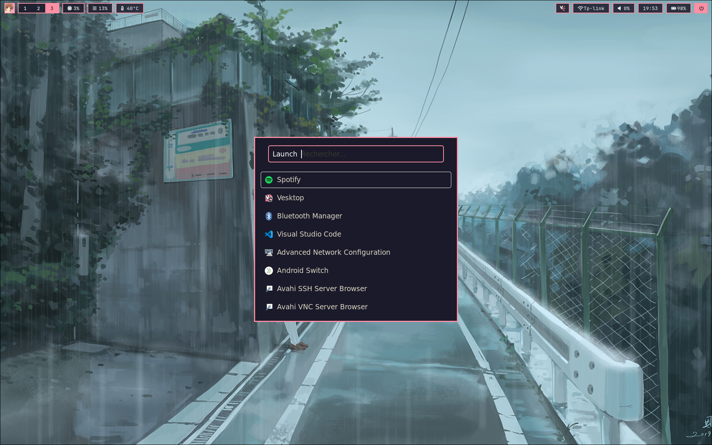
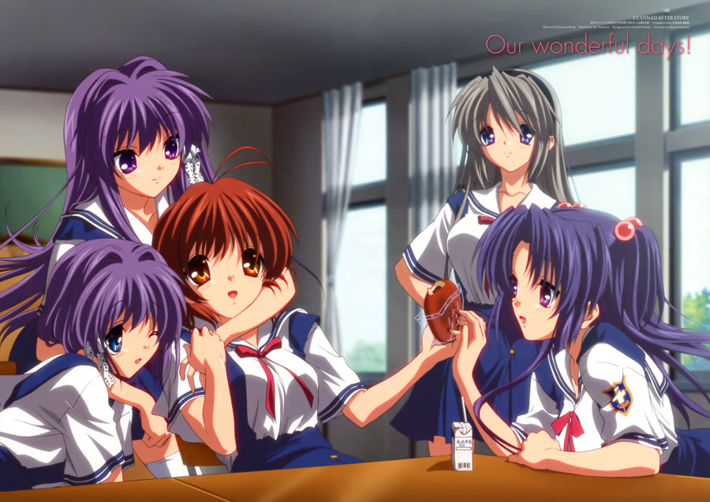

<h1 align="center">
  
  d a n g o ' s r i c e
  
</h1>

<p align="center">
  
  
  
</p>

<p align="center">
  
  
  
  
</p>

---

## Preview

<p align="center">
  
  
</p>

---

## About

A **Hyprland** rice with a **dark & pink** palette, inspired by **Clannad** and **Catppuccin**,
managed with plain symlinks so `~/.config` *is* this repo.

Heavily inspired by the amazing [HyDE Project](https://github.com/HyDE-Project/HyDE) and [DerAnsari's dots](https://github.com/DerAnsari/hyprland-dots).

---

## Components

| Component | Name |
|-----------|------|
| **Window Manager** | [Hyprland](https://hyprland.org/) — Lua config (≥ 0.57) |
| **Lockscreen** | hyprlock |
| **Status Bar** | Waybar (+ cava visualizer, rofi Wi-Fi menu) |
| **Launcher** | Rofi |
| **Notifications** | Dunst |
| **Wallpaper** | awww |
| **Terminal** | Kitty |
| **Shell** | Fish + [Tide](https://github.com/IlanCosman/tide) prompt |
| **Fetch** | Fastfetch (random logo on each launch) |
| **Font** | Hack Nerd Font |
| **GTK / Cursor** | Catppuccin Mocha Pink |
| **Music** | Spotify + Spicetify |
| **Discord** | Vesktop (System24 theme) |
| **Browser** | Zen |
| **File Manager** | Thunar |
| **Display Manager** | SDDM *(config not included)* |
| **Audio** | Pipewire / Wireplumber |

---

## Repository layout

```
Dotfiles/
├── install.sh        # symlink manager (install / uninstall / status / packages)
├── links.txt         # what gets linked where
├── packages.txt      # packages the rice needs
├── assets/           # README screenshots
└── config/           # one folder per app, mirrored into ~/.config
    ├── hypr/         #   hyprland.lua + lua/ modules, hyprlock, hypridle, hyprsunset, scripts, wallpapers
    ├── waybar/       #   bar config, style, scripts (cava, wifi-menu, power-menu)
    ├── quickshell/   #   wallpaper carousel (QML)
    ├── fish/  kitty/  rofi/  fastfetch/  dunst/  cava/
    ├── gtk-3.0/  gtk-4.0/  nwg-look/  xdg-desktop-portal/
    ├── spicetify/  vesktop/
    └── git/          #   no identity inside, see "Git identity" below
```

---

## Dependencies

```bash
./install.sh packages   # yay -S --needed everything in packages.txt
```

The Catppuccin Mocha Pink cursor comes from the [catppuccin/cursors releases](https://github.com/catppuccin/cursors/releases).

---

## Installation

```bash
git clone https://github.com/dangoquidev/Dotfiles.git ~/Dotfiles
cd ~/Dotfiles
./install.sh                       # interactive menu (whiptail), or install everything
./install.sh install hypr waybar   # only some groups
./install.sh status                # state of every link
./install.sh packages              # install the packages from packages.txt
./install.sh -n install            # dry-run, changes nothing
./install.sh uninstall [group…]    # remove links and restore backups
```

- Existing files are **never deleted**: they are moved to `~/.local/state/dotfiles/backup/<date>/` first.
- Since everything is symlinked, editing `~/.config/...` edits the repo: `git status` shows what changed.
- Post-install hooks: Fisher + Tide for `fish`, `spicetify apply` for `spicetify`, `hyprctl reload` for `hypr`.

> [!WARNING]
> Don't `git checkout` an old commit inside `~/Dotfiles`: your live config would change with it.
> Use `git worktree add /tmp/old <commit>` to look at old versions.

### Git identity

`config/git/config` has no personal info: it includes `~/.gitconfig.local`, which is not versioned.

```ini
[user]
	name = Your Name
	email = you@users.noreply.github.com
	signingkey = <GPG key ID>
```

### Adding a new config

1. Move the folder into `config/<name>`
2. Add a line to `links.txt`
3. `./install.sh install <group>`

---

## Keybinds

`SUPER` is the main modifier.

| Keys | Action |
|------|--------|
| `SUPER + T` | Terminal (kitty) |
| `SUPER + A` | App launcher (rofi) |
| `SUPER + B` | Browser (zen) |
| `SUPER + SHIFT + B` | Wallpaper carousel (`~/.config/hypr/wallpapers`, `~/Pictures/Wallpapers`): ←/→ rotate, Enter applies |
| `SUPER + E` | File manager (thunar) |
| `SUPER + Q` | Close window |
| `SUPER + V` | Toggle floating |
| `SUPER + SHIFT + V` | Clipboard history (cliphist) |
| `SUPER + L` | Lock screen |
| `SUPER + M` | Exit Hyprland |
| `SUPER + Escape` | Power menu (lock, suspend, log out, reboot, shut down) |
| `SUPER + C` | Color picker |
| `SUPER + P` | Screenshot area → clipboard |
| `SUPER + SHIFT + P` | Screenshot area → swappy |
| `SUPER + CTRL + P` | Screenshot area → `~/Pictures/Screenshots` |
| `Print` | Screenshot full screen → `~/Pictures/Screenshots` + clipboard |
| `SHIFT + Print` | Screenshot active window → `~/Pictures/Screenshots` + clipboard |
| `SUPER + W` | Wi-Fi menu |
| `SUPER + SHIFT + W` | Reload waybar |
| `SUPER + N` | Night light on / off (hyprsunset) |
| `SUPER + ←↑→↓` | Move focus |
| `SUPER + SHIFT + ←↑→↓` | Resize window |
| `SUPER + 1…0` | Go to workspace |
| `SUPER + SHIFT + 1…0` | Move window to workspace |
| `SUPER + CTRL + ←/→` | Previous / next workspace |
| `SUPER + CTRL + SHIFT + ←/→` | Move window to previous / next workspace |
| `SUPER + S` / `SUPER + SHIFT + S` | Toggle / send to scratchpad |
| `SUPER + LMB / RMB` | Drag / resize window |
| 3-finger swipe | Switch workspace |

### Idle (hypridle)

| After | Action |
|-------|--------|
| 2 min 30 | Dim the screen |
| 5 min | Lock |
| 5 min 30 | Screen off |
| 30 min | Suspend |

The session is always locked before a suspend (lid, power menu, idle). Timeouts live in `config/hypr/hypridle.conf`.

### Waybar

- **Left**: workspaces · clock · system (CPU, RAM, temperature, power profile) · updates (hidden when up to date) · music + cava
- **Center**: window title
- **Right**: tray · quick toggles (stay awake, night light, do not disturb) · Wi-Fi + Bluetooth · volume + brightness · battery · power menu

### Colors

One palette everywhere: Hyprland borders, waybar, rofi, dunst, hyprlock, kitty, Spotify (spicetify `text` theme,
`Rice` scheme), Vesktop (system24), GTK (Catppuccin Mocha Pink).

| Role | Color |
|------|-------|
| Base | `#1a1a2a` |
| Surface | `#252535` / `#2a2a3a` |
| Muted | `#3a3a4a` |
| Text | `#e0def4` |
| Pink | `#ff8fa3` |
| Light pink | `#ffd1dc` |
| Red | `#f7768e` |
| Mint | `#b8f5c8` |

### Background helpers

- **Wallpaper**: the last one is restored at login, and each change regenerates the blurred lockscreen image (`~/.cache/hypr/lock.jpg`).
- **Night light** (hyprsunset): warm screen (4000 K) from 20:30 to 7:00, schedule in `config/hypr/hyprsunset.conf`.
- **Low battery**: notification at 15 %, critical one at 5 % (`config/hypr/scripts/battery-notify.sh`).
- **Clipboard history**: cliphist records text and images, `SUPER + SHIFT + V` to pick one.

---

## TODO

### **Upcoming Features (hopefully...)**
- [ ] My own color palette for all applications
- [ ] Wallpaper switcher
- [x] Custom notification daemon configuration (dunst)
- [ ] Multiple theme, or anime based theme

---

## Credits & Inspiration

- **[HyDE Project](https://github.com/HyDE-Project/HyDE)** — Fastfetch and Hypr setup
- **[DerAnsari](https://github.com/DerAnsari/hyprland-dots)** — Rice inspiration
- **[Catppuccin](https://github.com/catppuccin)** — Color palette ideas
- **[pibble](https://github.com/kianblakley/pibble)** — Wallpaper carousel design

---

## Support

If you like this rice, consider giving it a star!

<p align="center">
  
</p>
