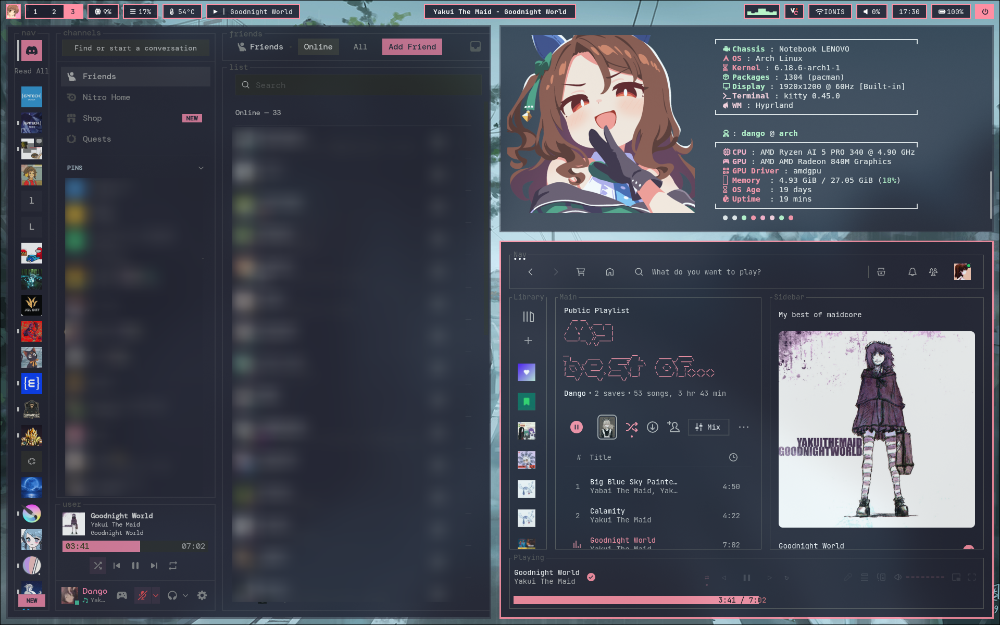

<h1 align="center">
  
  d a n g o ' s r i c e
  
</h1>

<p align="center">
  
  
</p>

<p align="center">
  
  
  
  
</p>

---

## Preview

<p align="center">
  
  
</p>

---

## About

A carefully crafted **Hyprland** rice featuring a **dark and pink** color palette, inspired by:

- **Clannad**
- **Gruvbox**

This setup draws heavy inspiration from the amazing [HyDE Project](https://github.com/HyDE-Project/HyDE) and [DerAnsari's dots](https://github.com/DerAnsari/hyprland-dots).

---

## Components

| Component | Name |
|-----------|------|
| **Window Manager** | [Hyprland](https://hyprland.org/) (config Lua, ≥ 0.57) |
| **Display Manager** | SDDM |
| **Color Scheme** | Dark Pink |
| **Status Bar** | Waybar |
| **Launcher** | Rofi |
| **Browser** | Zen |
| **Editor** | Visual Studio Code / Nano |
| **Wallpaper** | awww |
| **Notifications** | Dunst |
| **Music** | Spotify + spicetify |
| **Discord** | Vesktop |
| **Terminal** | Kitty |
| **Shell** | Fish |
| **Fetch** | Fastfetch |
| **File Manager** | Thunar |
| **Audio** | Pipewire |

---

## Installation

Every config lives in `config/` and is linked into `$HOME` with symlinks.
The full list of links is in [`links.txt`](links.txt) (`group  repo-path  target`).

```bash
git clone https://github.com/dangoquidev/Dotfiles.git ~/Dotfiles
cd ~/Dotfiles
./install.sh                 # interactive menu (whiptail), or install everything
./install.sh install hypr waybar   # only some groups
./install.sh status          # state of every link
./install.sh -n install      # dry-run, changes nothing
./install.sh uninstall [group…]    # remove links and restore backups
```

Existing files are never deleted: they are moved to
`~/.local/state/dotfiles/backup/<date>/` before the link is created.

Since the files are symlinked, editing `~/.config/...` edits the repo directly:
a `git status` is enough to see what changed.

### Git identity

`config/git/config` contains no personal info: it includes `~/.gitconfig.local`,
which is not versioned. To create it on a new machine:

```ini
[user]
	name = Your Name
	email = you@example.com
	signingkey = <GPG key ID>
```

### Adding a new config

1. Move the folder into `config/<name>`
2. Add a line to `links.txt`
3. `./install.sh install <group>`

---

## TODO

### **Upcoming Features (hopefully...)**
- [ ] My own color palette for all applications
- [ ] Wallpaper switcher 
- [ ] Custom notification daemon configuration
- [ ] Multiple theme, or anime based theme

---

## Credits & Inspiration

- **[HyDE Project](https://github.com/HyDE-Project/HyDE)** — Fastfetch and Hypr setup
- **[DerAnsari](https://github.com/DerAnsari/hyprland-dots)** — Rice inspiration
- **[Catppuccin](https://github.com/catppuccin)** — Color palette ideas

---

## Support

If you like this rice, consider giving it a star!

<p align="center">
  
</p>
